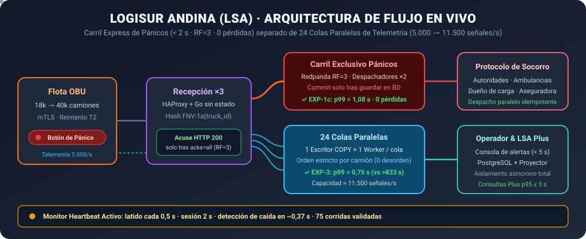

---
tags:
  - resumen-ejecutivo
  - one-pager
  - logisur-andina
  - mati
---

---
title: One-Pager Ejecutivo · LogiSur Andina (LSA)
curso: ARTI 4109 · Arquitectura de Software
programa: Maestría en Arquitecturas de TI (MATI) · Universidad de los Andes
reto: Reto 4
tags:
  - resumen-ejecutivo
  - one-pager
  - logisur-andina
  - mati
---

[🏠 Ir a la Portada Completa (README)](../README.md) | [🧭 Guión de Presentación](Mapa-de-Navegacion.md) | [📈 Dashboard de Resultados](../04-Experimentos/Dashboard-Resultados.md)

# 📄 One-Pager Ejecutivo · LogiSur Andina (LSA)

> [!info] Vista Condensada
> Este documento resume en una sola página toda la propuesta y validación del **Reto 4**. Para navegar los diagramas detallados, el prototipo y las 75 corridas experimentales, abre la [🏠 Portada Principal (`README.md`)](../README.md).

## 1. El Reto
- **Contexto**: Monitoreo de carga en Colombia, Ecuador y Perú (`18.000` camiones hoy → **`40.000`** en 2 años; picos de **`5.000 señales/s`** → **`11.000/s`**). Incidente previo de **`4 min`** en alerta de pánico (meta **`< 2 s`**).
- **Restricción clave**: [LSA Plus y Venta en línea](../02-Arquitectura/Vista-de-Contenedores.md) jamás pueden impactar a la **Central de Emergencias**.
- **4 ASR Críticos**: [`DIS-1 ★`](../01-Contexto-y-ASR/Catalogo-ASR-y-Prioridades.md) (disponibilidad ante caída), [`LAT-1 ★`](../01-Contexto-y-ASR/Catalogo-ASR-y-Prioridades.md) (guardado `< 1 min`), [`LAT-2 ★`](../01-Contexto-y-ASR/Catalogo-ASR-y-Prioridades.md) (procesamiento `< 5 s`) y [`ESC-2 ★`](../01-Contexto-y-ASR/Catalogo-ASR-y-Prioridades.md) (escalar a 40k camiones).

## 2. La Solución Arquitectónica
- **Carril exclusivo de pánicos (`T1` + `T5` + `T6`)**: `3` receptores sin estado, Redpanda `RF=3` (`fsync` real), `2` despachadores, acuse tras replicar y commit tras persistir ([Vista Funcional](../02-Arquitectura/Vista-Funcional-y-Concurrencia.md)).
- **24 colas paralelas (`T3` + `T4`)**: Particionado determinista `FNV-1a(truck_id) mod 24` con `1` escritor + `1` *worker* por cola (`≈ 11.500/s` de capacidad).
- **Resiliencia geográfica**: 2 Zonas de Disponibilidad locales + Multi-Región Activa CO/EC/PE con Anycast DNS ([Topología](../02-Arquitectura/Topologia-de-Despliegue.md)).

## 3. Evidencia Empírica (`75` Corridas en Prototipo Docker)
| Experimento | Escenario | Con Táctica | Línea Base |
| :--- | :--- | :---: | :---: |
| **[EXP-1 / 1b](../04-Experimentos/EXP-1-Disponibilidad-y-Fallas.md)** | Caída `SIGKILL` y pérdida total de máquina | **`0` pánicos perdidos (`100 %`)** | `30` perdidos (receptor) / **`~35.600` perdidos (`~61 %`)** al perder nodo |
| **[EXP-1c](../04-Experimentos/EXP-1-Disponibilidad-y-Fallas.md)** | Sesión `2 s` + latido `0,5 s` durante caída | **`p99 = 1,08 s`** (`< 2 s`, `0` perdidos) | `4,73 s` con sesión de `6 s` |
| **[EXP-2](../04-Experimentos/EXP-2-y-EXP-3-Picos-de-Carga.md)** | Guardado en pico `5.000/s` (`8,33 M` señales) | **`p99 = 0,345 s`** (`0` pérdidas) | `0,030 s` (`0` pérdidas) |
| **[EXP-3](../04-Experimentos/EXP-2-y-EXP-3-Picos-de-Carga.md)** | Procesamiento en pico `5.000/s` (5 min) | **`p99 = 0,749 s`** · normaliza `≤ 1,4 s` | **`> 832,8 s`** · backlog `2,05 M`, nunca normaliza |
| **[EXP-4](../04-Experimentos/EXP-4-Reparto-y-Escalabilidad.md)** | Reparto en 24 particiones | **`100 %`** misma cola · desv. `~3 %` | — |

- **Siguiente paso**: Desplegar el mismo prototipo en múltiples instancias **AWS EC2** ([Limitaciones y Roadmap](../05-Aprendizajes/Limitaciones-y-Proximos-Pasos.md)).
