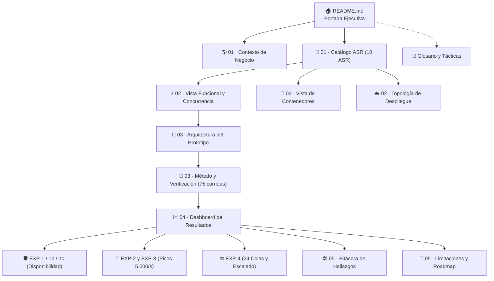

---
tags:
  - moc
  - presentacion
  - logisur-andina
---

---
title: Mapa de Navegación y Guión de Presentación
tags:
  - moc
  - presentacion
  - logisur-andina
---

[🏠 Inicio](../README.md) | ➡️ Siguiente: [🌎 Contexto de Negocio](../01-Contexto-y-ASR/Contexto-de-Negocio.md)

# 🧭 Mapa de Navegación y Guión de Presentación

Esta guía organiza el recorrido ideal para presentar el proyecto **LogiSur Andina (LSA)** ante una audiencia grande (directivos, arquitectos o jurado académico) en **15–20 minutos**, saltando directamente a cada nota y gráfico.

---

## 🗺️ Estructura Hiperconectada del Proyecto

---

## 🎤 Guión Sugerido para Exposición (Paso a Paso)

| Bloque | Tiempo | Nota a abrir en pantalla | Mensaje clave para la audiencia |
| :--- | :---: | :--- | :--- |
| **1. El gancho** | 2 min | [🏠 Portada](../README.md) + [🌎 Contexto](../01-Contexto-y-ASR/Contexto-de-Negocio.md) | Mostrar la animación en vivo y el dato real: en el último paro nacional un pánico tardó **4 minutos**; la flota pasará de `18.000` a `40.000` camiones. |
| **2. Qué importa de verdad** | 3 min | [🎯 Catálogo ASR](../01-Contexto-y-ASR/Catalogo-ASR-y-Prioridades.md) | Explicar por qué solo **4 de 10 ASR (`DIS-1`, `LAT-1`, `LAT-2`, `ESC-2`)** dictan la estructura arquitectónica y cómo el resto se resuelve sin complicar la central. |
| **3. La solución** | 4 min | [⚡ Funcional](../02-Arquitectura/Vista-Funcional-y-Concurrencia.md) · [🧱 Contenedores](../02-Arquitectura/Vista-de-Contenedores.md) · [☁️ Despliegue](../02-Arquitectura/Topologia-de-Despliegue.md) | Destacar las 4 tácticas (`T1–T4`), el **carril exclusivo de pánicos**, el aislamiento total de **LSA Plus** y la topología multi-región CO/EC/PE. |
| **4. Evidencia empírica** | 6 min | [📈 Dashboard](../04-Experimentos/Dashboard-Resultados.md) · [🛡️ EXP-1b/1c](../04-Experimentos/EXP-1-Disponibilidad-y-Fallas.md) · [🚀 EXP-3](../04-Experimentos/EXP-2-y-EXP-3-Picos-de-Carga.md) | Mostrar las dos pruebas estrella: **0 vs. ~35.600 pánicos perdidos** al morir un nodo (`EXP-1b`) y **`0,75 s` vs. `> 833 s`** con 24 colas frente a 1 cola (`EXP-3`). |
| **5. Rigor y cierre** | 3 min | [🛠️ Bitácora](../05-Aprendizajes/Bitacora-de-Hallazgos.md) · [🔭 Roadmap](../05-Aprendizajes/Limitaciones-y-Proximos-Pasos.md) | Mostrar transparencia técnica (el bypass de `fsync`, la sesión de `2 s`, las limitaciones de correr en 1 equipo) y el siguiente paso en **AWS EC2**. |

---

## 🔗 Enlaces Rápidos
- ¿Dudas sobre algún acrónimo técnico? Consulta el [📖 Glosario y Tácticas](Glosario-y-Tacticas.md).
- ¿Necesitas una vista condensada para imprimir o compartir? Revisa el [📄 One-Pager Ejecutivo](../LogiSur-Andina-Propuesta-Arquitectura.md).
