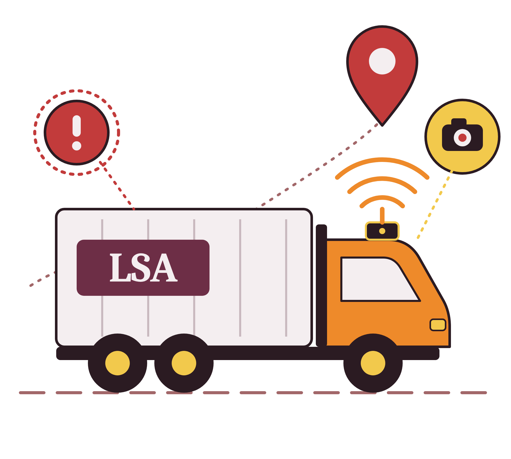
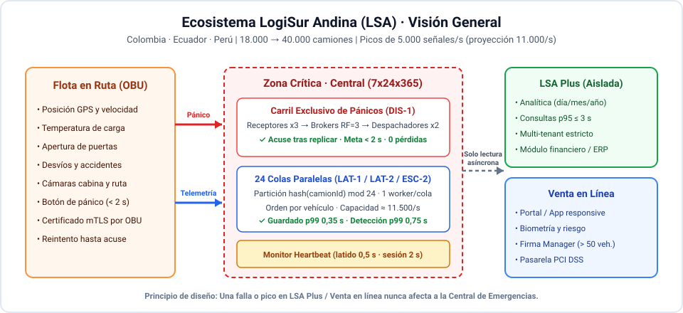

---
tags:
  - contexto
  - negocio
  - logisur-andina
---

---
title: Contexto de Negocio
tags:
  - contexto
  - negocio
  - logisur-andina
---

[🏠 Inicio](../README.md) | [➡️ Los 10 ASR](Catalogo-ASR-y-Prioridades.md)

# 🌎 Contexto de Negocio · LogiSur Andina

> [!danger] El detonante del proyecto
> En el último paro nacional, una alerta de botón de pánico tardó **4 minutos** en llegar a un operador. La meta es **`< 2 segundos`**, mientras la flota crece más del doble en 2 años.

---

## 📊 Cifras Clave

| Hoy | En 2 años |
| :--- | :--- |
| `18.000` camiones (CO, EC y PE) | **`40.000` camiones** |
| `1.500 señales/s` normal · `5.000/s` en pico | **`≈ 11.000 señales/s` en pico** |
| Pánico en **`4 min`** en picos · venta presencial | Pánico **`< 2 s`** · anomalías **`< 5 s`** · **`0` pérdidas** |

---

## 🧭 Los Tres Frentes

1. **Central de Emergencias (`7x24x365`)**: Pánicos `< 2 s`, anomalías `< 5 s`, `5.000 señales/s` sin perder ninguna.
2. **Venta en Línea**: App/portal con validación de identidad e ingresos, sin suplantación y firma del Manager si supera `50` vehículos.
3. **LSA Plus**: Analítica (diaria, mensual, anual), alertas configurables, financiero y roles. Consultas `< 3 s` y aislamiento multi-cliente.

> [!warning] Regla de oro
> **Ninguna falla ni carga alta en LSA Plus o Venta en línea puede afectar a la Central de Emergencias.**

---

**Siguiente:** [🎯 Los 10 ASR y Prioridades](Catalogo-ASR-y-Prioridades.md)
