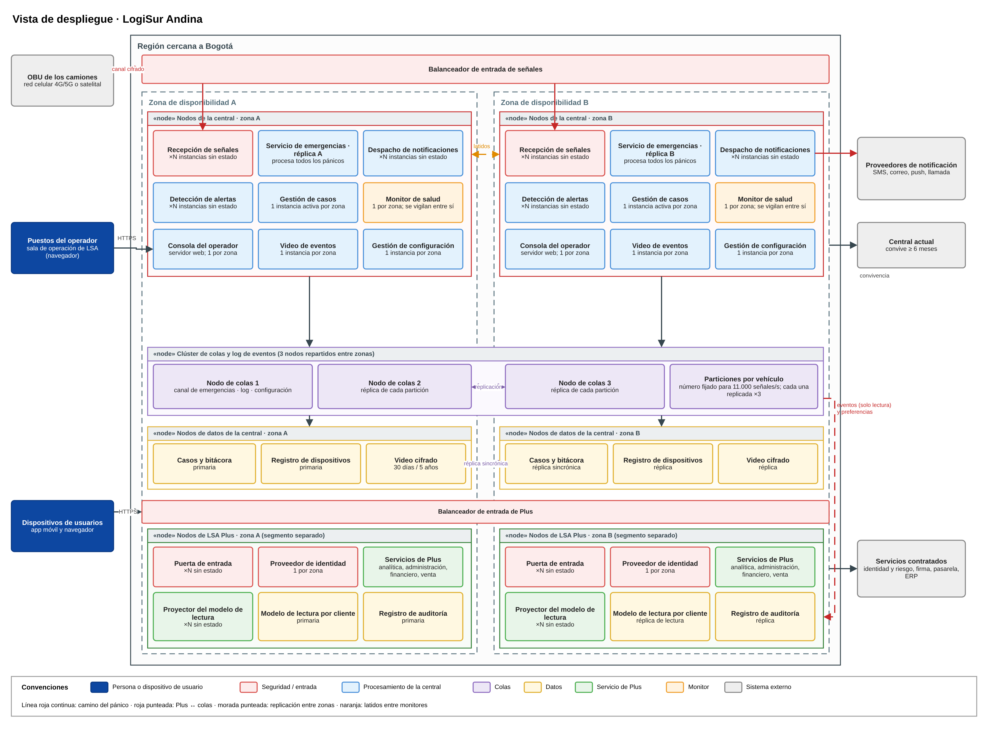
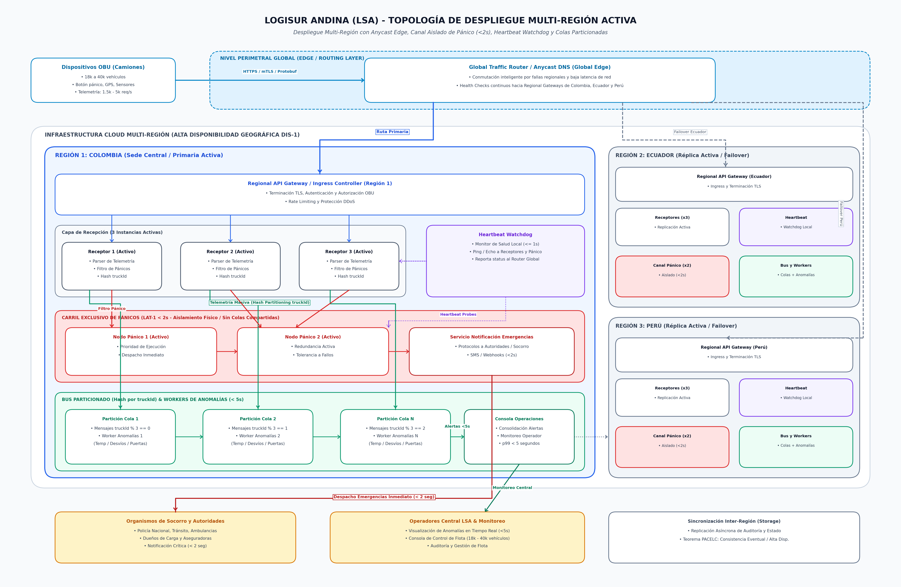

---
tags:
  - arquitectura
  - despliegue
  - alta-disponibilidad
  - multi-region
  - logisur-andina
---

---
title: Topología de Despliegue (Multi-AZ y Multi-Región)
tags:
  - arquitectura
  - despliegue
  - alta-disponibilidad
  - multi-region
  - logisur-andina
---

[🏠 Inicio](../README.md) | [⬅️ Contenedores](Vista-de-Contenedores.md) | [➡️ Prototipo](../03-Prototipo-y-Metodo/Arquitectura-del-Prototipo.md)

# ☁️ Topología de Despliegue

Resiliencia en dos capas: **2 Zonas de Disponibilidad** en la región principal y **Failover Multi-Región Activa** entre Colombia, Ecuador y Perú.

---

## 1. Despliegue Regional (Cercano a Bogotá · Zona A y Zona B)

- **Balanceadores separados** para entrada de señales OBU y para LSA Plus.
- **Clúster de 3 nodos de colas** repartidos entre zonas con particiones replicadas `×3` (dimensionado para `11.000/s`).
- **Réplica sincrónica** entre zonas para `Casos y bitácora`, y **segmento separado** para LSA Plus.

---

## 2. Topología Multi-Región Activa (Colombia · Ecuador · Perú)

- **Anycast DNS / Global Edge**: Enruta por baja latencia y conmuta automáticamente hacia Ecuador o Perú si falla Colombia.
- **PACELC inter-región**: Replicación asíncrona de auditoría y estado entre países para no sacrificar la meta `< 2 s` del carril de pánico.

---

**Siguiente:** [🐳 Arquitectura del Prototipo (12 Contenedores)](../03-Prototipo-y-Metodo/Arquitectura-del-Prototipo.md)
