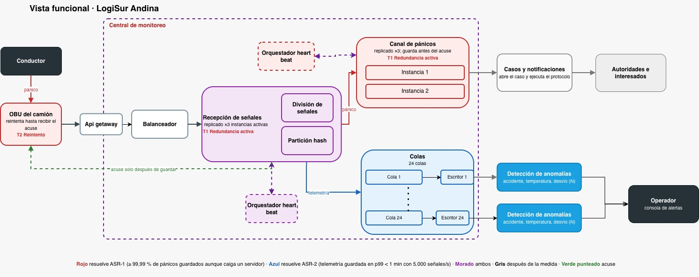
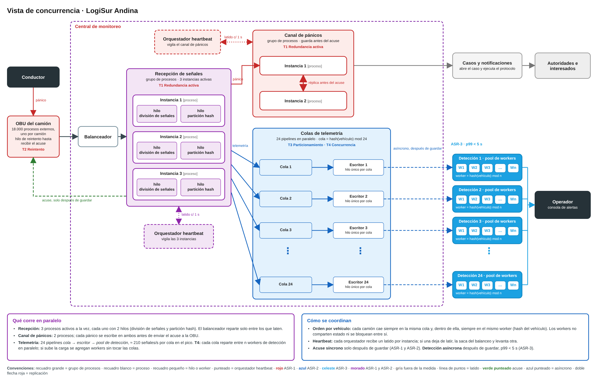

---
tags:
  - arquitectura
  - concurrencia
  - tacticas
  - logisur-andina
---

---
title: Vista Funcional y de Concurrencia
tags:
  - arquitectura
  - concurrencia
  - tacticas
  - logisur-andina
---

[🏠 Inicio](../README.md) | [⬅️ Los 10 ASR](../01-Contexto-y-ASR/Catalogo-ASR-y-Prioridades.md) | [➡️ Contenedores](Vista-de-Contenedores.md)

# ⚡ Vista Funcional y de Concurrencia

Separamos físicamente el **carril de pánicos** (prioridad absoluta y replicación `×3` antes del acuse) de las **24 colas paralelas de telemetría** (procesamiento en `< 5 s` respetando el orden por camión).

---

## 1. Vista Funcional (Ruta Crítica)

---

## 2. Vista de Concurrencia y Coordinación

---

## 🛡️ Las 4 Tácticas que Sostienen esta Vista

- **T1 · Redundancia activa**: `3` receptores activos + `2` despachadores + brokers replicados `×3`.
- **T2 · Reintento en OBU**: El camión guarda y reintenta hasta recibir el **acuse síncrono** (enviado solo tras replicar).
- **T3 · Particionamiento (`hash mod 24`)**: Cada camión cae siempre en la misma cola (`≈ 210 señales/s` por cola en pico).
- **T4 · Concurrencia aislada**: `1` escritor + pool de *workers* por cola → detección asíncrona en `p99 < 5 s` y `0` desorden.
- **Heartbeat**: Vigila instancias cada `0,5 s` (sesión `2 s`, ajustado en [EXP-1c](../04-Experimentos/EXP-1-Disponibilidad-y-Fallas.md)).

---

**Siguiente:** [🧱 Vista de Contenedores (Aislamiento)](Vista-de-Contenedores.md)
