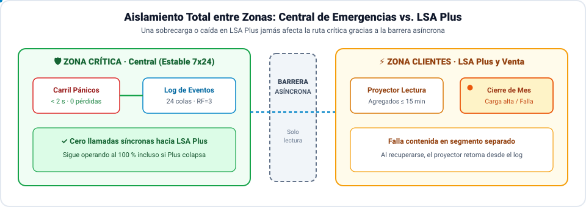
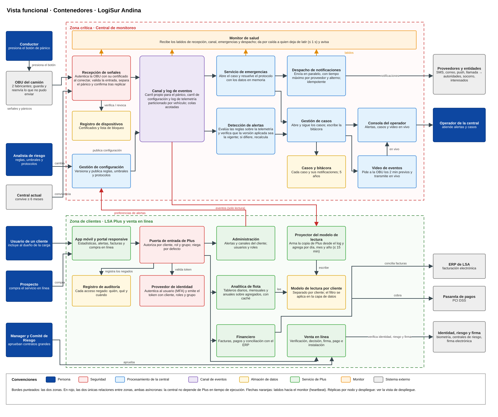

---
tags:
  - arquitectura
  - contenedores
  - aislamiento
  - logisur-andina
---

---
title: Vista de Contenedores (Aislamiento de Zonas)
tags:
  - arquitectura
  - contenedores
  - aislamiento
  - logisur-andina
---

[🏠 Inicio](../README.md) | [⬅️ Vista Funcional](Vista-Funcional-y-Concurrencia.md) | [➡️ Despliegue](Topologia-de-Despliegue.md)

# 🧱 Vista Funcional de Contenedores

Dos mundos físicamente separados para garantizar que **LSA Plus nunca afecte a la Central de Emergencias**.

---

## 🗺️ Diagrama Oficial de Contenedores

- **Zona Crítica (Rojo)**: mTLS por OBU (`SEG-1`), carril exclusivo de pánicos, motor de alertas con versión de regla (`DIS-4` / `MOD-1`), video bajo demanda (`2 min` previos + vivo) y convivencia `≥ 6 meses` con la central actual.
- **Zona de Clientes (Verde)**: Puerta de entrada que niega por defecto, MFA, aislamiento multi-tenant en datos, agregados (`≤ 15 min`) con caché (`p95 ≤ 3 s`), ERP y Venta en línea (biometría, riesgo, firma y PCI DSS).
- **Acoplamiento**: Solo **2 flujos asíncronos** (eventos en solo lectura hacia el Proyector y preferencias de alertas hacia Configuración).

---

**Siguiente:** [☁️ Topología de Despliegue (Multi-AZ y Multi-Región)](Topologia-de-Despliegue.md)
