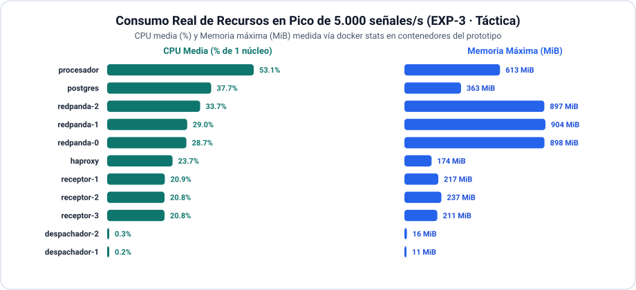

---
tags:
  - prototipo
  - docker
  - redpanda
  - logisur-andina
---

---
title: Arquitectura del Prototipo
tags:
  - prototipo
  - docker
  - redpanda
  - logisur-andina
---

[🏠 Inicio](../README.md) | [⬅️ Despliegue](../02-Arquitectura/Topologia-de-Despliegue.md) | [➡️ Método](Metodo-y-Verificacion.md)

# 🐳 Prototipo Experimental (12 Contenedores)

Un único [`docker-compose.yml`](../evidencia/docker-compose.yml) portable entre local y **AWS EC2**: **Go 1.23** (`franz-go`, `pgx`) · **Redpanda 24.2** (`fsync` real) · **HAProxy 3.0** · **PostgreSQL 16** (sin índices para contar duplicados) · **Python 3**.

---

## ⚖️ Táctica vs. Línea Base

| Parámetro | ✅ Con Táctica | ❌ Base `EXP-1 / 1b` | ❌ Base `EXP-2 / 3` |
| :--- | :---: | :---: | :---: |
| **Brokers / Réplicas** | `3` / **`RF=3`** | `1` / `RF=1` | `3` / `RF=3` |
| **Receptores / Despachadores** | **`3` / `2`** | `1` / `1` | `3` / — |
| **Acuse / Commit** | **Tras replicar (`acks=all`) / Tras guardar** | Inmediato / Auto-commit `1 s` | Tras replicar |
| **Colas / Workers** | **`24` / `24`** | `24` / `24` | **`1` / `1`** |

Ver detalle de los 7 servicios del prototipo

- **Generador (`obusim`)**: Simula `18.000` camiones (`~1 KB`), ráfagas de pánico, pérdidas de cobertura (`5,5 %`) y reintentos (`100 ms → 2 s`).
- **HAProxy**: Balanceo HTTP con *health check* cada `1 s`.
- **Receptores ×3**: Enrutamiento determinista manual `FNV-1a(truck_id) mod 24`.
- **Redpanda ×3**: `unsafe-bypass-fsync=false`, `write_caching=false`, `enable_leader_balancer=false`.
- **Despachadores ×2**: Grupo de consumo de pánicos con `COMMIT_MODE=after_write`.
- **Procesador**: `24` *pipelines* (`COPY` a Postgres → *worker* de detección con costo simulado `2 ms/señal`).
- **Orquestador (`run.py` / `analyze.py`)**: Limpia estado, inyecta `SIGKILL`, vigila *heartbeat* y cruza BD vs. generador.

---

**Siguiente:** [🧪 Método y Verificación Independiente](Metodo-y-Verificacion.md)
