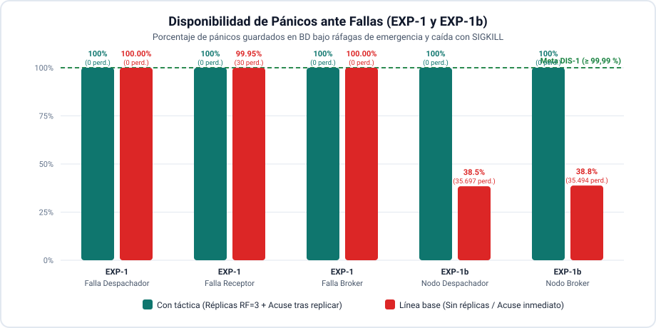
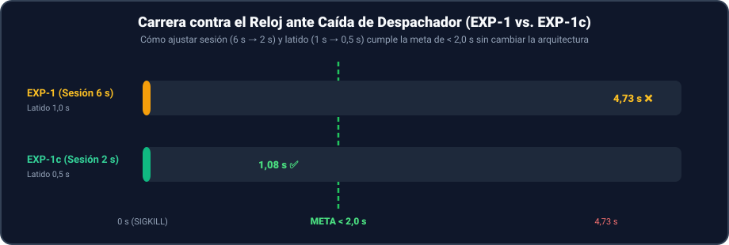
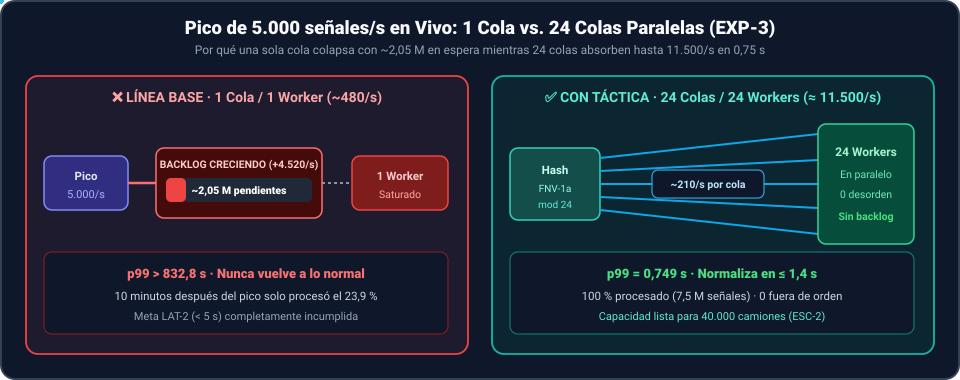
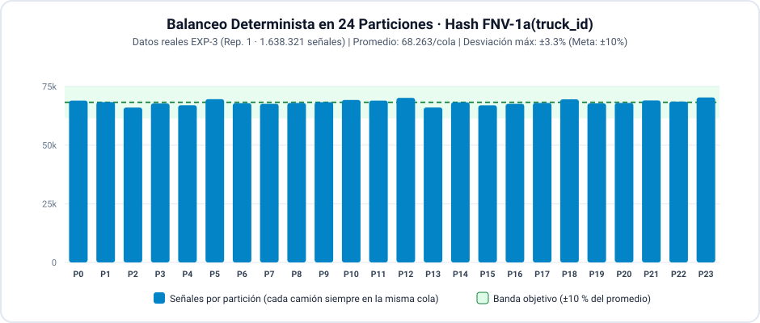

---
tags:
  - resultados
  - dashboard
  - logisur-andina
---

---
title: Dashboard Visual de Resultados (75 Corridas)
tags:
  - resultados
  - dashboard
  - logisur-andina
---

[🏠 Inicio](../README.md) | [⬅️ Método](../03-Prototipo-y-Metodo/Metodo-y-Verificacion.md) | [➡️ EXP-1 Disponibilidad](EXP-1-Disponibilidad-y-Fallas.md)

# 📈 Dashboard Visual de Resultados (`75` Corridas)

Evidencia consolidada del **13–14 nov 2026** ([📄 Resumen de criterios](../evidencia/resumen-criterios.md) · [🌐 Informe HTML completo](../evidencia/informe-experimental.html)).

---

## 1. Disponibilidad ante Fallas (`EXP-1` y `EXP-1b`) → [Ver detalle](EXP-1-Disponibilidad-y-Fallas.md)

---

## 2. Carrera de Detección para Cumplir `< 2 s` (`EXP-1c`) → [Ver detalle](EXP-1-Disponibilidad-y-Fallas.md)

---

## 3. Pico de `5.000/s`: 1 Cola vs. 24 Colas (`EXP-2` y `EXP-3`) → [Ver detalle](EXP-2-y-EXP-3-Picos-de-Carga.md)

---

## 4. Reparto en 24 Particiones (`EXP-4` / `ESC-2`) → [Ver detalle](EXP-4-Reparto-y-Escalabilidad.md)

