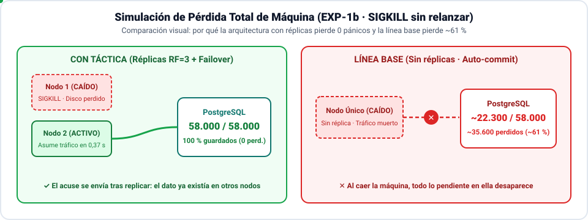
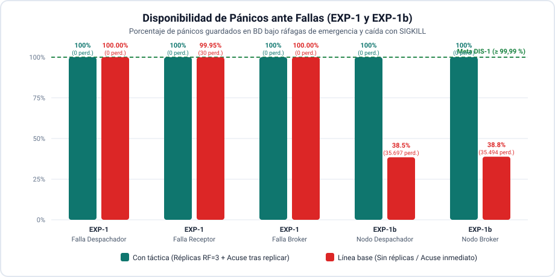
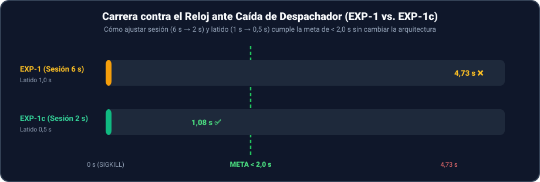
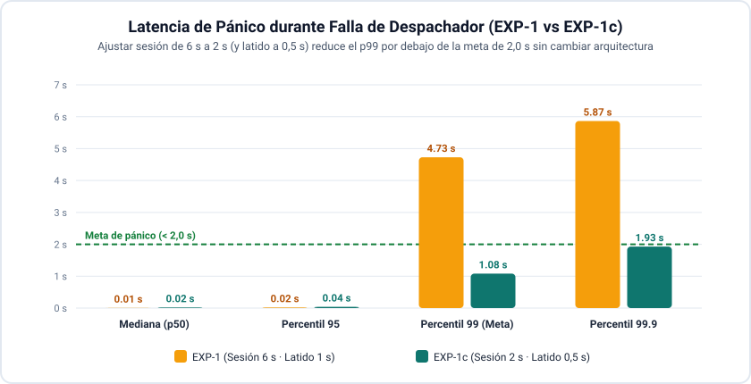

---
tags:
  - exp-1
  - disponibilidad
  - failover
  - logisur-andina
---

---
title: EXP-1, EXP-1b y EXP-1c · Disponibilidad (DIS-1)
tags:
  - exp-1
  - disponibilidad
  - failover
  - logisur-andina
---

[🏠 Inicio](../README.md) | [⬅️ Dashboard](Dashboard-Resultados.md) | [➡️ EXP-2 y EXP-3](EXP-2-y-EXP-3-Picos-de-Carga.md)

# 🛡️ EXP-1, EXP-1b y EXP-1c · Disponibilidad (`DIS-1 ★`)

> [!success] Veredicto
> **0 pánicos perdidos** en todas las fallas (`174.000` pánicos en `EXP-1` y `58.000` por escenario en `EXP-1b`), y **`p99 = 1,08 s`** (`< 2 s`) al ajustar la sesión a `2 s` en `EXP-1c`.

---

## 1. Pérdida Total de Máquina (`EXP-1b`)

| Escenario | ✅ Con Táctica | ❌ Línea Base |
| :--- | :---: | :---: |
| **EXP-1 · Falla receptor (`SIGKILL`)** | **`0` perdidos (`100 %`)** | `30` pánicos y `645` acusadas perdidas (`99,914 %`) |
| **EXP-1b · Nodo despachador perdido** | **`0` perdidos (`100 %`)** | **`35.697` pánicos perdidos (`37,99 %`)** |
| **EXP-1b · Nodo broker perdido** | **`0` perdidos (`100 %`)** | **`35.494` pánicos y `2,27 M` señales perdidas (`38,75 %`)** |

---

## 2. Meta `< 2 s` con Configuración (`EXP-1c`)

Ajustando **sesión `6 s → 2 s`** y **latido `1 s → 0,5 s`** (sin cambiar la arquitectura), la detección bajó a `0,37 s` y el `p99` cayó de `4,73 s` a **`1,08 s`** (`0` pánicos perdidos).

---

**Siguiente:** [🚀 EXP-2 y EXP-3 · Picos de 5.000 señales/s](EXP-2-y-EXP-3-Picos-de-Carga.md)
