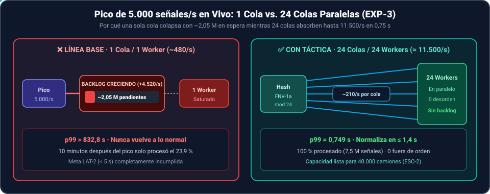
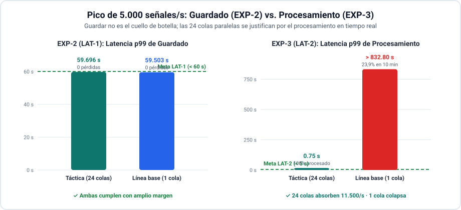
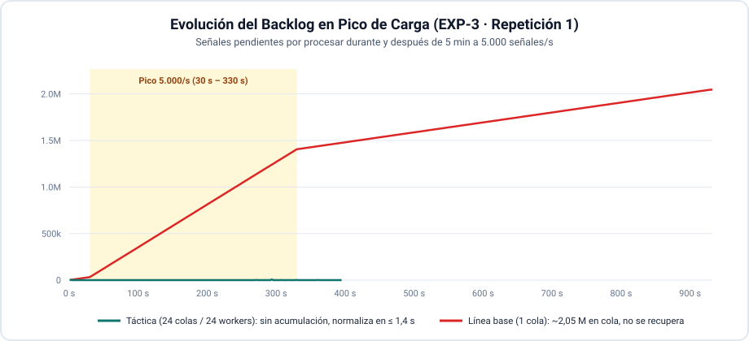

---
tags:
  - exp-2
  - exp-3
  - latencia
  - backlog
  - logisur-andina
---

---
title: EXP-2 y EXP-3 · Picos de 5.000/s (LAT-1 y LAT-2)
tags:
  - exp-2
  - exp-3
  - latencia
  - backlog
  - logisur-andina
---

[🏠 Inicio](../README.md) | [⬅️ EXP-1 Disponibilidad](EXP-1-Disponibilidad-y-Fallas.md) | [➡️ EXP-4 Reparto](EXP-4-Reparto-y-Escalabilidad.md)

# 🚀 EXP-2 y EXP-3 · Picos de `5.000 señales/s`

> [!tip] Hallazgo clave
> **Guardar (`EXP-2`) no es el cuello de botella.** Las **24 colas paralelas** se justifican por el **procesamiento en tiempo real (`EXP-3`)**: `0,75 s` frente a un colapso de `> 833 s` con una sola cola.

---

## 📊 Guardado (`EXP-2`) vs. Procesamiento y Backlog (`EXP-3`)

| Métrica (Pico `5.000/s` por 5 min) | ✅ Táctica (`24` colas) | ❌ Base (`1` cola) |
| :--- | :---: | :---: |
| **EXP-2 (`LAT-1`) · `p99` guardado** | **`0,345 s`** (`0` pérdidas) | `0,030 s` (`0` pérdidas) |
| **EXP-3 (`LAT-2`) · `p99` detección** | **`0,749 s`** (`0` desorden) | **`> 832,8 s`** |
| **Vuelta a la normalidad (`ESC-1`)** | **`0,8 – 1,4 s`** (`100 %` procesado) | **Nunca** (`2,05 M` backlog · `23,9 %` en 10 min) |
| **Capacidad agregada (`ESC-2`)** | **`≈ 11.500 señales/s`** (`24 × 480/s`) | `~480 señales/s` |

---

**Siguiente:** [⚖️ EXP-4 · Reparto en 24 Particiones](EXP-4-Reparto-y-Escalabilidad.md)
