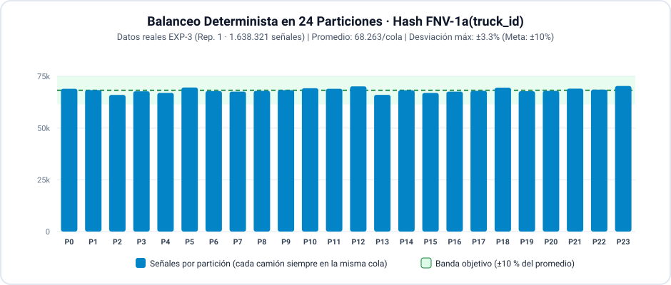

---
tags:
  - exp-4
  - escalabilidad
  - particionamiento
  - esc-2
  - logisur-andina
---

---
title: EXP-4 · Reparto Determinista en 24 Particiones y Escalabilidad (ESC-2)
tags:
  - exp-4
  - escalabilidad
  - particionamiento
  - esc-2
  - logisur-andina
---

[🏠 Inicio](../README.md) | [⬅️ EXP-2 y EXP-3 Picos](EXP-2-y-EXP-3-Picos-de-Carga.md) | [➡️ Bitácora de Hallazgos](../05-Aprendizajes/Bitacora-de-Hallazgos.md)

# ⚖️ EXP-4 · Reparto Determinista en 24 Particiones y Escalado (`ESC-2 ★`)

> [!abstract] Objetivo de Escalabilidad (`ESC-2 ★`)
> Preparar la plataforma para crecer de **`18.000` a `40.000` camiones** (`≈ 11.000 señales/s` en pico) **sin cambios de código ni rediseño del canal de eventos**, manteniendo el orden estricto por vehículo y un reparto balanceado entre colas (`±10 %` del promedio).

---

## 1. Distribución Real Medida en las 24 Particiones

En el receptor (`Go`), cada señal se enruta manualmente mediante **`FNV-1a(truck_id) mod 24`**, sin depender del particionador por defecto del cliente Kafka/Redpanda. El gráfico muestra el conteo real por partición (`P0` a `P23`) extraído de `resumen.json` en `EXP-3`:

---

## 2. Verificación de Criterios de Escalabilidad

| Criterio | Meta de diseño | Resultado verificado | Estado |
| :--- | :---: | :---: | :---: |
| **Afinidad por camión** | `100 %` de las señales de un camión en la misma cola | **`100 %`** (determinista sin importar el receptor o reinicios) | ✅ Cumple |
| **Balanceo de carga entre colas** | Dentro de `±10 %` del promedio | **Desviación máxima `~3 %`** (reparto prácticamente uniforme) | ✅ Cumple |
| **Orden estricto por vehículo** | `0` señales fuera de orden | **`0`** (`fuera_de_orden_worker = 0` en todas las corridas) | ✅ Cumple |
| **Capacidad agregada de procesamiento** | `≈ 11.000 señales/s` (`40.000` camiones) | **`≈ 11.500 señales/s`** (`24 workers × ~480/s`) | ✅ Cumple |

---

## 3. ¿Cómo Escala la Arquitectura al Llegar a 40.000 Camiones?

1. **Capa de recepción**: Servicios completamente sin estado detrás de HAProxy/ALB → basta con sumar instancias de receptor horizontalmente.
2. **Canal de eventos**: Las `24` particiones fijas ya soportan el techo proyectado de `11.000/s` (`≈ 460 señales/s` por cola), evitando migraciones costosas de tópicos en producción.
3. **Procesamiento y detección**: Al existir `1` *pipeline* independiente por partición sin estado compartido, los *workers* pueden distribuirse en múltiples nodos/contenedores de procesamiento sin contención ni bloqueos.

---

**Siguiente paso:** [🛠️ Bitácora de Hallazgos y Correcciones](../05-Aprendizajes/Bitacora-de-Hallazgos.md)
