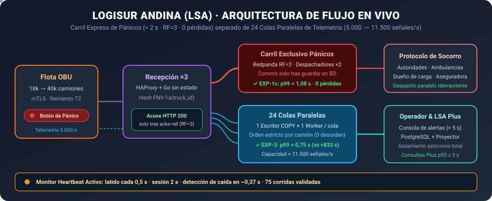

---
tags:
  - moc
  - logisur-andina
  - arquitectura-software
  - reto-4
---

---
title: LogiSur Andina (LSA) · Reto 4
curso: ARTI 4109 · Arquitectura de Software
programa: Maestría en Arquitecturas de TI (MATI) · Universidad de los Andes
tags:
  - moc
  - logisur-andina
  - arquitectura-software
  - reto-4
---

# LogiSur Andina (LSA) — Propuesta de arquitectura

**ARTI 4109 · Arquitectura de Software · Reto 4 · Maestría en Arquitecturas de TI (Universidad de los Andes)**

En este repositorio reunimos la propuesta de arquitectura para la plataforma de monitoreo de flota de **LogiSur Andina** (Colombia, Ecuador y Perú) junto con los resultados de las **75 corridas** ejecutadas sobre el prototipo en Docker.

- **Presentación interactiva:** abre [`index.html`](index.html) en el navegador (o en GitHub Pages).
- **Repositorio de documentación y presentación:** [github.com/DaveGuarnizo/MATI-ArqSoft-Reto4](https://github.com/DaveGuarnizo/MATI-ArqSoft-Reto4)
- **Repositorio del prototipo y resultados completos (75 corridas):** [github.com/Feru34/Arquisoft-Reto4-Resultados](https://github.com/Feru34/Arquisoft-Reto4-Resultados)

---

## Qué probamos y qué encontramos

| Escenario                                     |        Meta         |           Con nuestra arquitectura           |          Línea base          | Detalle                                                            |
| :-------------------------------------------- | :-----------------: | :------------------------------------------: | :--------------------------: | :----------------------------------------------------------------- |
| **Caída / pérdida de nodo (`DIS-1`)**         | `≥ 99,99 %` pánicos |          **`100 %` (`0` perdidos)**          | `~35.600` perdidos (`~61 %`) | [EXP-1 y EXP-1b](04-Experimentos/EXP-1-Disponibilidad-y-Fallas.md) |
| **Tiempo de pánico durante la falla**         |      `< 2,0 s`      |      **`1,08 s`** (`p99`, sesión `2 s`)      |   `4,73 s` (sesión `6 s`)    | [EXP-1c](04-Experimentos/EXP-1-Disponibilidad-y-Fallas.md)         |
| **Pico de `5.000 señales/s` (`LAT-2`)**       |     `p99 < 5 s`     |    **`0,75 s`** · normaliza en `≤ 1,4 s`     | `> 833 s` · `2,05 M` en cola | [EXP-2 y EXP-3](04-Experimentos/EXP-2-y-EXP-3-Picos-de-Carga.md)   |
| **Crecimiento a `40.000` camiones (`ESC-2`)** |    `≈ 11.000/s`     | **`≈ 11.500/s`** (`24` colas · desv. `~3 %`) |     `~480/s` (`1` cola)      | [EXP-4](04-Experimentos/EXP-4-Reparto-y-Escalabilidad.md)          |

---

## Contenido del repositorio

1. **Contexto y requisitos:** [Contexto de negocio](01-Contexto-y-ASR/Contexto-de-Negocio.md) · [Catálogo de los 10 ASR](01-Contexto-y-ASR/Catalogo-ASR-y-Prioridades.md)
2. **Vistas de arquitectura:** [Vista funcional y concurrencia](02-Arquitectura/Vista-Funcional-y-Concurrencia.md) · [Vista de contenedores](02-Arquitectura/Vista-de-Contenedores.md) · [Topología de despliegue](02-Arquitectura/Topologia-de-Despliegue.md)
3. **Prototipo y pruebas:** [Arquitectura del prototipo](03-Prototipo-y-Metodo/Arquitectura-del-Prototipo.md) · [Método y verificación](03-Prototipo-y-Metodo/Metodo-y-Verificacion.md)
4. **Resultados:** [Resumen visual](04-Experimentos/Dashboard-Resultados.md) · [EXP-1 / 1b / 1c](04-Experimentos/EXP-1-Disponibilidad-y-Fallas.md) · [EXP-2 y EXP-3](04-Experimentos/EXP-2-y-EXP-3-Picos-de-Carga.md) · [EXP-4](04-Experimentos/EXP-4-Reparto-y-Escalabilidad.md)
5. **Cierre:** [Bitácora de hallazgos](05-Aprendizajes/Bitacora-de-Hallazgos.md) · [Limitaciones y siguiente paso](05-Aprendizajes/Limitaciones-y-Proximos-Pasos.md)

**Otros archivos:** [Guión de presentación](00-Inicio/Mapa-de-Navegacion.md) · [Glosario](00-Inicio/Glosario-y-Tacticas.md) · [Resumen en una página](00-Inicio/LogiSur-Andina-Propuesta-Arquitectura.md) · [Informe HTML](evidencia/informe-experimental.html) · [docker-compose.yml](evidencia/docker-compose.yml)

---

## Equipo y cliente

- **Equipo:** Juan Camilo Caicedo España · Karol García Bohórquez · Felipe Rueda · David Fernando Guarnizo
- **Cliente:** Javier Rodríguez
